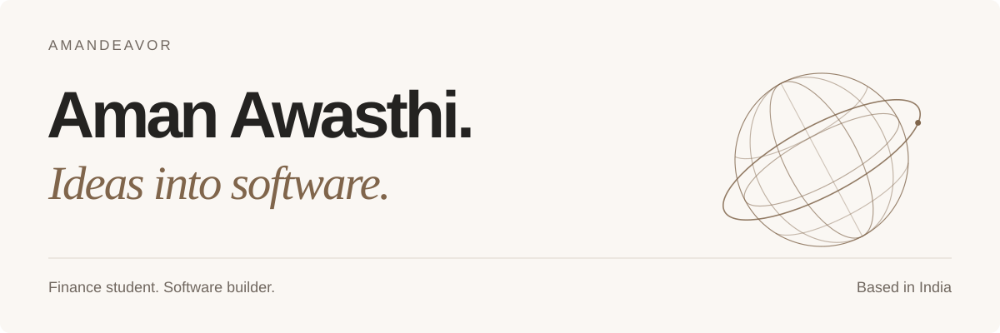

<a href="https://amandeavor.pages.dev/">
  <picture>
    <source media="(prefers-color-scheme: dark)" srcset="./assets/profile-header-dark.svg" />
    
  </picture>
</a>

 

  

 

## About

I'm **Aman Awasthi**, a software builder studying **Banking & Finance** in India.

Alongside my B.Com (Hons.) and CA Foundation preparation, I build **developer tools, browser applications and Linux systems**. I like work where the details matter: a command that previews its changes, an error that explains what happened, a fix someone else can review.

<table>
  <tr>
    <td><b>Studying</b> B.Com (Hons.) · CA Foundation</td>
    <td><b>Building</b> AI-workflow CLIs, file tools, a Void Linux desktop</td>
    <td><b>Contributing</b> Fixes, tests and docs across dev tooling</td>
  </tr>
</table>

 

## Toolbox

 

## Selected work

| Project | What it does | Stack |
| --- | --- | --- |
| [**Aetheris OS**](https://github.com/amandeavor/Aetheris-OS) | Experimental, hardware-aware desktop system on Void Linux, with installation, setup and software-management tools. | `Rust` `C` `Svelte` `Tauri` `runit` |
| [**Aman CLI**](https://github.com/amandeavor/Aman-CLI) | One place for your AI workflows: organize skills, prompts and MCP configs, with read-only diagnostics. | `TypeScript` `Node.js` |
| [**Momentum**](https://github.com/amandeavor/Momentum) | Expo productivity app for tasks, habits, focus sessions and personal planning. | `TypeScript` `Expo` |
| [**ObsidianKit**](https://github.com/amandeavor/ObsidianKit) | Browser-native toolbox for document, image, media, calculator and utility workflows. | `React` `TypeScript` `Vite` |
| [**Sweepr**](https://github.com/amandeavor/Sweepr) | Terminal file organizer with dry-run previews and undo manifests. | `Python` `Typer` `Rich` |

<a href="https://amandeavor.pages.dev/projects/">View all work on my portfolio →</a>

 

## Open-source contributions

I help maintain [**opencode-mem**](https://github.com/tickernelz/opencode-mem) and [**awesome-free-apps**](https://github.com/Axorax/awesome-free-apps), and contribute fixes, tests and docs to developer tools.

| **37** | **20** | **138** |
| :---: | :---: | :---: |
| merged PRs in external repos | external repositories | merged PRs overall |

Verified October 25, 2026 · <a href="./CONTRIBUTIONS.md">Browse the contribution record →</a>

| Project | Selected merged work |
| --- | --- |
| **opencode-mem** | [Reduce storage overhead for new vector indexes](https://github.com/tickernelz/opencode-mem/pull/279), [do not mark failed tag migrations as processed](https://github.com/tickernelz/opencode-mem/pull/319), [show matched-memory counts](https://github.com/tickernelz/opencode-mem/pull/290) |
| **compio** | [Skip empty UDP datagrams in QUIC endpoint](https://github.com/compio-rs/compio/pull/1070) |
| **Uno Platform** | [Correct Compass ReportInterval support for iOS and WASM](https://github.com/unoplatform/uno/pull/24655) |
| **RTK** | [Count rtk uv rows as Python](https://github.com/rtk-ai/rtk/pull/4328), [count sudo RTK_DISABLED=1 commands as bypass](https://github.com/rtk-ai/rtk/pull/3808) |
| **Wave** | [Handle non-UTF-8 program output in the case runner](https://github.com/wavefnd/Wave/pull/743), [reject null write buffers](https://github.com/wavefnd/Wave/pull/742) |
| **Inversify** | [Validate OpenAPI base-URI declarations](https://github.com/inversify/monorepo/pull/2104), [discriminated errors in HTTP error filters](https://github.com/inversify/monorepo/pull/2108) |
| **test-reporter** | [Surface PHPUnit JUnit error details](https://github.com/dorny/test-reporter/pull/834), [attribute-only failure messages](https://github.com/dorny/test-reporter/pull/814) |
| **vitepress-carbon** | [Import markdown-it as a type only](https://github.com/brenoepics/vitepress-carbon/pull/346), [drop invalid `:deep()` from DocSearch styles](https://github.com/brenoepics/vitepress-carbon/pull/345) |
| **svg2pdf.js** | [Align PDF link hit boxes with rendered SVG elements](https://github.com/yWorks/svg2pdf.js/pull/372) |
| **awesome-free-apps** | [Link audits detect HTTP failures, limit concurrency, return meaningful exit codes](https://github.com/Axorax/awesome-free-apps/pull/296) |
| **jest-codemods** | [Preserve TypeScript `this` parameters during migration](https://github.com/skovhus/jest-codemods/pull/672) |
| **repodx · rolecraft · shep · freeCodeCamp** | [Public env-prefix secrets](https://github.com/omerbek/repodx/pull/29) · [UserError for skill-not-found](https://github.com/rolecraft-sh/rolecraft/pull/298) · [doc comment fixes](https://github.com/shep-pm/shep/pull/621) · [lecture terminology](https://github.com/freeCodeCamp/freeCodeCamp/pull/70378) |

<b>Currently under review</b>

 

- [reticle #1085](https://github.com/reticlehq/reticle/pull/1085): `verify --expect-file` and PowerShell usage docs
- [ComfyUI_frontend #18817](https://github.com/Comfy-Org/ComfyUI_frontend/pull/18817): refuse overwriting existing specs in the test recorder
- [less.js #4549](https://github.com/less/less.js/pull/4549): leave `min()`/`max()` intact when args contain CSS vars
- [claude-devtools #244](https://github.com/matt1398/claude-devtools/pull/244): preserve scroll position across tab switches
- [rtk #4330](https://github.com/rtk-ai/rtk/pull/4330): stable example command per discover bucket
- [helix #16309](https://github.com/helix-editor/helix/pull/16309): selection terminology in docs
- [snakemake #4324](https://github.com/snakemake/snakemake/pull/4324): correct conda environment storage path docs
- [Axl #433](https://github.com/Observal/Axl/pull/433): highlight Containerfile, Dockerfile.* and shell dotfiles in the TUI

Open pull requests as of October 25, 2026.

 

## How I work

| | |
| --- | --- |
| **Understand the failure** | Reproduce it before changing the implementation. |
| **Make the fix reviewable** | Keep changes focused and add regression coverage where it helps. |
| **Leave a clear trail** | Document actual behavior, explain failures and make changes reversible. |

 

## Notes from building

- [Linux desktop latency: find the cause before tuning](https://amandeavor.pages.dev/blog/optimizing-desktop-latency/)
- [Privacy-first React components: storage and safe defaults](https://amandeavor.pages.dev/blog/privacy-first-components/)
- [Using an AI coding CLI: context, permissions and diff review](https://amandeavor.pages.dev/blog/command-line-ai/)

 

**Have something in mind?** [Tell me about it →](https://amandeavor.pages.dev/#contact)

