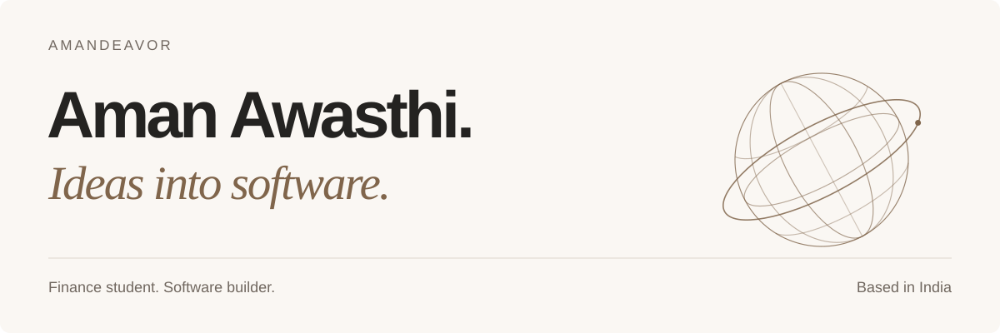

<a href="https://amandeavor.pages.dev/">
  <picture>
    <source media="(prefers-color-scheme: dark)" srcset="./assets/profile-header-dark.svg" />
    
  </picture>
</a>

 

  

 

## About

I'm **Aman Awasthi**, a software builder studying **Banking & Finance** in India.

Alongside my B.Com (Hons.) and CA Foundation preparation, I build **developer tools, browser applications and Linux systems**. I like work where the details matter: a command that previews its changes, an error that explains what happened, a fix someone else can review.

<table>
  <tr>
    <td><b>Studying</b> B.Com (Hons.) · CA Foundation</td>
    <td><b>Building</b> AI-workflow CLIs, file tools, a Void Linux desktop</td>
    <td><b>Contributing</b> Fixes, tests and docs across dev tooling</td>
  </tr>
</table>

 

## Toolbox

 

## Selected work

| Project | What it does | Stack |
| --- | --- | --- |
| [**Aetheris OS**](https://github.com/amandeavor/Aetheris-OS) | Experimental, hardware-aware desktop system on Void Linux, with installation, setup and software-management tools. | `Rust` `C` `Svelte` `Tauri` `runit` |
| [**Aman CLI**](https://github.com/amandeavor/Aman-CLI) | One place for your AI workflows: organize skills, prompts and MCP configs, with read-only diagnostics. | `TypeScript` `Node.js` |
| [**Momentum**](https://github.com/amandeavor/Momentum) | Expo productivity app for tasks, habits, focus sessions and personal planning. | `TypeScript` `Expo` |
| [**ObsidianKit**](https://github.com/amandeavor/ObsidianKit) | Browser-native toolbox for document, image, media, calculator and utility workflows. | `React` `TypeScript` `Vite` |
| [**Sweepr**](https://github.com/amandeavor/Sweepr) | Terminal file organizer with dry-run previews and undo manifests. | `Python` `Typer` `Rich` |

<a href="https://amandeavor.pages.dev/projects/">View all work on my portfolio →</a>

 

## Open-source contributions

I help maintain [**opencode-mem**](https://github.com/tickernelz/opencode-mem) and [**awesome-free-apps**](https://github.com/Axorax/awesome-free-apps), and contribute fixes, tests and docs to developer tools.

| **58** | **30** | **159** |
| :---: | :---: | :---: |
| merged PRs in external repos | external repositories | merged PRs overall |

Verified November 9, 2026 · <a href="./CONTRIBUTIONS.md">Browse the contribution record →</a>

| Project | Selected merged work |
| --- | --- |
| **ComfyUI** | [Refuse overwriting existing specs by default in the test recorder](https://github.com/Comfy-Org/ComfyUI_frontend/pull/22918) |
| **Wave** | [Validate the command vector before indexing Cargo subcommands](https://github.com/wavefnd/Wave/pull/1051), [include the Whale workspace manifest in the FreeBSD cache identity](https://github.com/wavefnd/Wave/pull/1046), [deduplicate WebAssembly smoke-runner validation](https://github.com/wavefnd/Wave/pull/1045), [handle non-UTF-8 program output in the case runner](https://github.com/wavefnd/Wave/pull/743), [reject null write buffers](https://github.com/wavefnd/Wave/pull/742) |
| **AMD Gaia** | [Document the 10-minute timeout for script shell commands](https://github.com/amd/gaia/pull/5758), [document the `max_steps` framework default of 50](https://github.com/amd/gaia/pull/5759), [add auth headers to stateful agent email examples](https://github.com/amd/gaia/pull/5760) |
| **jest-codemods** | [Map `property('callCount', n)` to `toHaveBeenCalledTimes`](https://github.com/skovhus/jest-codemods/pull/673), [split `expect().and.to` chains into separate expects](https://github.com/skovhus/jest-codemods/pull/674), [convert concise arrow-body assertions for expect-js](https://github.com/skovhus/jest-codemods/pull/675), [preserve TypeScript `this` parameters during migration](https://github.com/skovhus/jest-codemods/pull/672) |
| **backlot** | [Write HTML 4 named entities into storage and keep single quotes as-is](https://github.com/brekkylab/backlot/pull/1017), [answer 404 for slash-free paths that match a slashed route](https://github.com/brekkylab/backlot/pull/1015) |
| **Tracekit** | [Add the E21 blind evaluation pool for amandeavor](https://github.com/Cygnux-Labs/Tracekit/pull/401) |
| **reticle** | [Add `verify --expect-file` and document PowerShell usage](https://github.com/reticlehq/reticle/pull/1085), [stop presenting unattributed listeners as this app](https://github.com/reticlehq/reticle/pull/1089) |
| **compio** | [Invert `may_fragment` polarity in the QUIC endpoint](https://github.com/compio-rs/compio/pull/1071) |
| **svg2pdf.js** | [Drop all-zero stroke-dasharray when emitting PDF](https://github.com/yWorks/svg2pdf.js/pull/382) |
| **vitepress-carbon** | [Move `@types/node` to devDependencies and bump to 26](https://github.com/brenoepics/vitepress-carbon/pull/369) |
| **gossh · aragonite · py-simple-wrap · Pyfun** | [Document browser terminal access via `--web` and `/term`](https://github.com/ankushT369/gossh/pull/58) · [Draw the list-collapse icon for the details insert entry](https://github.com/voithos-labs/aragonite/pull/793) · [Pizza Party Bill Splitter tutorial](https://github.com/sara-czasak/py-simple-wrap/pull/495) · [Say `and N more` when a typed-hole refinement list is cut](https://github.com/simontreanor/Pyfun/pull/165) |

<b>Currently under review</b>

 

- [bq40z50 #100](https://github.com/OpenDevicePartnership/bq40z50/pull/100): rename bit 25 of PF_ALERT/MAC_PF_ALERT from OPNC to OPNCELL
- [py-simple-wrap #634](https://github.com/sara-czasak/py-simple-wrap/pull/634): add the Type Hints Template to the Contributor Hub
- [snowopslabs #149](https://github.com/sagar2395/snowopslabs/pull/149): document shell tab-completion in the CLI reference and README
- [bq40z50 #102](https://github.com/OpenDevicePartnership/bq40z50/pull/102): clarify PartialDataFlashWrite committed-byte reporting
- [aragonite #792](https://github.com/voithos-labs/aragonite/pull/792): pin the plugin-guide opener priority table to OPENER_PRIORITIES
- [reticle #1878](https://github.com/reticlehq/reticle/pull/1878): document scrolling by fraction with an example
- [reticle #1877](https://github.com/reticlehq/reticle/pull/1877): document driving with Playwright while Reticle is embedded
- [wemux #102](https://github.com/wemux-ai/wemux/pull/102): add an en/zh i18n key parity check
- [Axl #433](https://github.com/Observal/Axl/pull/433): highlight Containerfile, Dockerfile.* and shell dotfiles in the TUI
- [Axl #432](https://github.com/Observal/Axl/pull/432): define THINKING_LEVELS in one place
- [Axl #431](https://github.com/Observal/Axl/pull/431): document Vim mode keys in the README
- [rtk #4330](https://github.com/rtk-ai/rtk/pull/4330): pick a stable example command per discover bucket
- [claude-devtools #244](https://github.com/matt1398/claude-devtools/pull/244): preserve scroll position and bottom-docking across tab switches
- [claude-devtools #243](https://github.com/matt1398/claude-devtools/pull/243): suppress notifications for historical tool-result errors
- [connectonion #1936](https://github.com/openonion/connectonion/pull/1936): refuse unsupported edit, delete and react before requiring credentials
- [LibreUML #131](https://github.com/LibreUML/LibreUML/pull/131): write edge-anchoring screenshots under `os.tmpdir()`
- [LibreUML #132](https://github.com/LibreUML/LibreUML/pull/132): clear `no-explicit-any` in diagram hook controller tests
- [helix #16309](https://github.com/helix-editor/helix/pull/16309): use `main` and `rotating` selection terminology in docs
- [less.js #4549](https://github.com/less/less.js/pull/4549): leave `min()`/`max()` intact when args contain CSS vars
- [snakemake #4324](https://github.com/snakemake/snakemake/pull/4324): correct conda environment storage path and hash-input docs

Open pull requests as of November 9, 2026.

 

## How I work

| | |
| --- | --- |
| **Understand the failure** | Reproduce it before changing the implementation. |
| **Make the fix reviewable** | Keep changes focused and add regression coverage where it helps. |
| **Leave a clear trail** | Document actual behavior, explain failures and make changes reversible. |

 

## Notes from building

- [Linux desktop latency: find the cause before tuning](https://amandeavor.pages.dev/blog/optimizing-desktop-latency/)
- [Privacy-first React components: storage and safe defaults](https://amandeavor.pages.dev/blog/privacy-first-components/)
- [Using an AI coding CLI: context, permissions and diff review](https://amandeavor.pages.dev/blog/command-line-ai/)

 

**Have something in mind?** [Tell me about it →](https://amandeavor.pages.dev/#contact)

